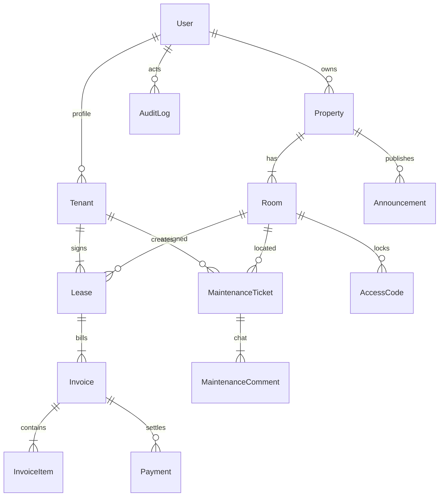

<div align="center">

# 🏠 Homia OS — Smart Property & Boarding House Management Platform

**Platform SaaS Manajemen Properti, Kos-kosan & Apartemen Modern Berbasis Cloud**

[](https://homia-app-2-black.vercel.app/dashboard)
[](https://nextjs.org/)
[](https://www.typescriptlang.org/)
[](https://tailwindcss.com/)
[](https://nestjs.com/)
[](https://www.prisma.io/)
[](https://www.postgresql.org/)
[](https://turbo.build/)
[](LICENSE)

---

### 🌐 Akses Langsung Demo Aplikasi:
### 👉 [https://homia-app-2-black.vercel.app/dashboard](https://homia-app-2-black.vercel.app/dashboard)

*Aplikasi web sudah aktif secara publik di cloud (Vercel Global Edge Network). Siapapun dapat langsung membuka tautan di atas tanpa perlu instalasi tambahan.*

---

[🌐 Live Demo](#-tautan-langsung-demo-halaman) • [📖 Tentang Aplikasi](#-tentang-homia-os) • [✨ Fitur Manajer](#-1-property-manager-dashboard-pengelola--owner) • [📱 Fitur Tenant](#-2-tenant-mobile-portal-penyewa--penghuni) • [⚡ Fitur Unggulan](#-3-portfolio--ux-differentiators) • [🛠️ Arsitektur](#-tech-stack--arsitektur-sistem) • [🗄️ Database](#-desain-basis-data-prisma-schema) • [🚀 Jalankan Lokal](#-panduan-instalasi--menjalankan-lokal) • [🔑 Akun Demo](#-akun-demo-default)

</div>

---

## 🌐 Tautan Langsung Demo Halaman

Anda dapat langsung mengeklik tautan di bawah ini untuk menguji setiap modul dan halaman yang telah berjalan secara *live*:

| Modul / Halaman | URL Live Demo | Fungsi & Yang Bisa Dicoba |
|---|---|---|
| 🏠 **Executive Dashboard** | [Buka Dashboard](https://homia-app-2-black.vercel.app/dashboard) | Kartu KPI finansial, grafik tren pendapatan bulanan, rasio okupansi, tagihan jatuh tempo & tiket darurat |
| 🛏️ **Visual Room Grid** | [Buka Room Grid](https://homia-app-2-black.vercel.app/rooms) | Grid visual warna kamar, filter lantai & status. **Klik kamar mana saja** untuk membuka *Slide-in Drawer* detail kontrak & riwayat unit |
| 🏢 **Multi-Property** | [Buka Properti](https://homia-app-2-black.vercel.app/properties) | Manajemen portofolio gedung kos (*Homia Stay Menteng* & *Homia Stay Kemang*) |
| 👥 **Tenant Management** | [Buka Data Penyewa](https://homia-app-2-black.vercel.app/tenants) | Registrasi penyewa, verifikasi identitas KTP, nomor WhatsApp & kontak darurat |
| 📄 **Lease Agreements** | [Buka Kontrak Sewa](https://homia-app-2-black.vercel.app/leases) | Pelacakan masa kontrak kamar, deposit jaminan, dan peringatan perpanjangan sewa otomatis (**H-14**, **H-7**) |
| 🧾 **Invoices & Billing** | [Buka Invoicing](https://homia-app-2-black.vercel.app/invoices) | Daftar tagihan bulanan dan simulasi mesin otomatisasi pembuatan tagihan sewa bulanan |
| 💳 **Payments Ledger** | [Buka Pembayaran](https://homia-app-2-black.vercel.app/payments) | Antrean verifikasi bukti transfer m-banking penyewa & buku besar transaksi *immutable* |
| 🔧 **Maintenance Kanban** | [Buka Kanban Board](https://homia-app-2-black.vercel.app/maintenance) | Papan kanban 5 tahap tiket komplain dengan **penghitung mundur SLA live** & indikator status darurat |
| 📢 **Broadcast Announcements** | [Buka Pengumuman](https://homia-app-2-black.vercel.app/announcements) | Penyiaran pengumuman bersegmen target spesifik (*Semua Penghuni*, *Per Gedung*, *Per Lantai*, atau *Kamar Tertentu*) |
| 📊 **Financial Analytics** | [Buka Analitik](https://homia-app-2-black.vercel.app/analytics) | Dashboard analitik komprehensif tabulasi: Tren Pendapatan (MRR), Komparasi Gedung, Rasio Pembayaran & Statistik Komplain |
| 🛡️ **Audit Logs & Security** | [Buka Audit Trail](https://homia-app-2-black.vercel.app/audit-logs) | Log rekam jejak audit administratif yang tidak dapat dimanipulasi lengkap dengan tombol **Export CSV** |
| 🔐 **Smart Lock Simulator** | [Buka Smart Lock](https://homia-app-2-black.vercel.app/settings) | Generator PIN akses fisik pintu 6-digit dengan batas waktu kadaluarsa (*TTL*) & simulasi integrasi IoT |
| 📱 **Tenant Mobile Portal** | [Buka Tenant Portal](https://homia-app-2-black.vercel.app/tenant/dashboard) | Antarmuka ramah ponsel dengan kartu kamar gradien, info tagihan jatuh tempo & navigasi bawah |
| 📱 **Tenant Billing Details** | [Buka Tenant Billing](https://homia-app-2-black.vercel.app/tenant/billing) | Rincian transparan invoice sewa, listrik, air, Wi-Fi & modal unggah bukti transfer |
| 📱 **Tenant Maintenance** | [Buka Tenant Tiket](https://homia-app-2-black.vercel.app/tenant/maintenance) | Formulir pengajuan keluhan fasilitas kamar oleh penyewa & pemantauan status pengerjaan |
| 📱 **Tenant Lease Info** | [Buka Tenant Kontrak](https://homia-app-2-black.vercel.app/tenant/lease) | Dokumen kontrak digital, inventaris barang kamar, dan tata tertib hunian kos |
| 📱 **Tenant Profile & KYC** | [Buka Tenant Profil](https://homia-app-2-black.vercel.app/tenant/profile) | Data identitas terdaftar, nomor KTP, dan nomor kontak keluarga darurat |
| 📱 **Tenant Notifications** | [Buka Notifikasi](https://homia-app-2-black.vercel.app/tenant/notifications) | Pusat pemberitahuan keluar-masuk (Invoice baru, pembayaran diverifikasi, pengumuman air/listrik) |
| 🔑 **Authentication Screen** | [Buka Halaman Login](https://homia-app-2-black.vercel.app/login) | Tampilan antarmuka login SaaS *split-screen* modern |

---

## 📖 Tentang Homia OS

Pengelolaan bisnis indekos (kos-kosan), *co-living*, dan apartemen di Indonesia sering kali menghadapi tantangan manual yang menghabiskan waktu:
- Catatan pembayaran tercecer di chat WhatsApp dan buku tulis manual.
- Tagihan listrik dan sewa sering kali terlewat jatuh temponya atau keliru dihitung.
- Keluhan fasilitas (AC mati, kran bocor, Wi-Fi lambat) terlambat direspons tanpa adanya standar waktu layanan (*SLA*).
- Riwayat penghuni dan dokumen identitas tidak tersimpan secara terpusat dan aman.
- Pengelola kesulitan memantau performa keuangan multi-gedung secara komprehensif.

**Homia OS** hadir sebagai solusi berbasis SaaS (*Software-as-a-Service*) terintegrasi yang mendigitalisasi dan mengotomatisasi seluruh siklus hidup pengelolaan properti sewa dari hulu ke hilir.

### Konsep Arsitektur Portal Ganda (*Dual-Portal System*):
1. **🏢 Property Manager Dashboard**: Dirancang untuk layar desktop bagi pemilik (*Owner*) dan staf pengelola untuk mengendalikan operasional gedung secara cepat, efisien, dan kaya data.
2. **📱 Tenant Mobile Portal**: Dirancang secara *mobile-first* bagi penyewa kamar agar mudah diakses langsung melalui peramban ponsel pintar tanpa perlu mengunduh aplikasi terpisah.

---

## ✨ Fitur Komprehensif Aplikasi

### 🏢 1. Property Manager Dashboard (Pengelola & Owner)

#### A. Multi-Property Overview & KPI Metrik
- Mengontrol portofolio lebih dari satu gedung kos dalam satu platform.
- Metrik real-time: Total Properti, Total Kamar, Kamar Terisi, Kamar Tersedia, Kamar Perbaikan, Tingkat Okupansi (%), Total Omset Bulanan, Piutang Tertunda (*Outstanding*), dan Tagihan Jatuh Tempo (*Overdue*).

#### B. Interactive Visual Room Grid & Slide-in Drawer
- Tampilan kartu grid kamar visual dengan kode warna status operasional:
  - 🟢 **AVAILABLE**: Kamar siap huni dan dapat disewakan segera.
  - 🔵 **OCCUPIED**: Kamar sedang disewa dan dihuni aktif.
  - 🟣 **RESERVED**: Kamar telah dipesan/dibooking dengan uang muka.
  - 🟡 **MAINTENANCE**: Kamar dalam proses pembersihan atau perbaikan teknis.
  - 🔴 **OVERDUE**: Penyewa belum membayar sewa melewati batas jatuh tempo.
- **Filter Multi-Kriteria**: Filter instan berdasarkan lantai gedung (*Lantai 1, Lantai 2, Lantai 3*), status ketersediaan, serta pencarian nomor kamar.
- **Slide-in Drawer**: Mengeklik kartu kamar mana saja akan memunculkan panel laci di sisi kanan layar berisi profil penyewa, nomor WhatsApp, kontrak sewa aktif, tagihan berjalan, fasilitas kamar, dan tombol aksi cepat (*Generate Invoice*, *Laporkan Kerusakan*).

#### C. Tenant Management (KYC & Dokumen Identitas)
- Perekaman identitas resmi: Nama lengkap, email, nomor WhatsApp aktif, tanggal lahir, jenis & nomor KTP/Paspor, foto profil, dan status verifikasi.
- Penyimpanan kontak darurat keluarga (nama & nomor telepon) untuk penanganan insiden darurat.

#### D. Lease Management & Automated Expiry Alerts
- Pelacakan siklus hidup kontrak: Tanggal mulai sewa, tanggal berakhir sewa, nominal sewa bulanan, uang jaminan deposit, dan tanggal jatuh tempo pembayaran setiap bulan.
- **Deteksi Otomatis Kontrak Habis**: Sistem otomatis mendeteksi masa sewa yang akan berakhir (**H-30**, **H-14**, **H-7**) dan memberikan peringatan mencolok untuk mempermudah negosiasi perpanjangan (*renewal*) atau persiapan audit serah-terima kunci kamar.

#### E. Smart Automated Billing Engine (Idempotent)
- Mengkalkulasi invoice bulanan terperinci:
  - Sewa Pokok Kamar
  - Pemakaian Listrik (Kwh / Token)
  - Biaya Air Bersih
  - Iuran Internet Wi-Fi
  - Biaya Parkir Kendaraan
  - Denda Keterlambatan (*Late Fee*)
  - Potongan Promosi / Diskon
- **Jaminan Idempotensi**: Dilengkapi pengunci status `BillingJob` komposit unik `[tenantId, leaseId, periodMonth, periodYear]`, memastikan tidak akan pernah terjadi pembuatan tagihan ganda (*duplicate charges*) meskipun proses otomasi dijalankan berulang kali.

#### F. Immutable Payment Ledger & Verifikasi Struk
- Antrean khusus bagi pengelola untuk meninjau bukti transfer yang diunggah penyewa.
- Pengelola dapat memverifikasi (*Approve*) atau menolak (*Reject*) pembayaran dengan catatan alasan.
- **Buku Besar Abadi (*Immutable*)**: Catatan pembayaran lama tidak pernah ditimpa atau dihapus demi menjamin integritas pembukuan dan audit finansial.

#### G. Maintenance Kanban Board dengan Live SLA Countdown
- Papan kanban 5 kolom: **OPEN** ➔ **IN PROGRESS** ➔ **WAITING** ➔ **RESOLVED** ➔ **CLOSED**.
- **Indikator Prioritas**: *Urgent (Merah)*, *High (Oranye)*, *Medium (Biru)*, *Low (Abu-abu)*.
- **Timer SLA Real-Time**: Menghitung lama waktu tiket sejak dibuat hingga batas waktu *Service Level Agreement* (contoh: Darurat maksimal 4 jam). Terdapat peringatan otomatis *Approaching SLA* atau *Breached SLA*.

#### H. Targeted Announcements System
- Mempublikasikan pengumuman penting (contoh: pembersihan toren air berkala, perbaikan Wi-Fi malam hari, jam malam gerbang utama).
- **Targeting Fleksibel**: Siarkan ke seluruh penghuni (*All Tenants*), gedung spesifik, lantai tertentu, atau kamar tertentu saja.

#### I. Simulasi IoT Smart Lock (Access Codes)
- Menghasilkan kode PIN digital 6-digit sementara dengan batas waktu kedaluwarsa (*validFrom* hingga *validUntil*) dan kuota maksimal pemakaian.
- Berguna untuk akses sementara teknisi AC, petugas kebersihan, atau calon penghuni yang ingin survei kamar.

#### J. Financial Analytics & Visualisasi Data (Recharts)
- Grafik area interaktif (*AreaChart*) membandingkan realisasi pendapatan versus target omset.
- Grafik donat (*DonutChart*) distribusi okupansi kamar.
- Grafik batang (*BarChart*) perbandingan pendapatan antar gedung properti dan rekapitulasi kategori komplain fasilitas terbanyak.

#### K. Audit Log Security Trail
- Rekam jejak audit keamanan otomatis mencatat setiap tindakan kritis (siapa aktornya, peran, tipe aksi, entitas yang diubah, timestamp, dan alamat IP).
- Tombol **Export to CSV** untuk pelaporan pembukuan eksternal.

---

### 📱 2. Tenant Mobile Portal (Penyewa / Penghuni)

- **Antarmuka Mobile-First**: Dioptimalkan untuk navigasi satu tangan pada layar ponsel pintar dengan *Bottom Navigation Bar*.
- **Ringkasan Kamar & Kontrak**: Menampilkan informasi kamar yang sedang disewa, fasilitas terpasang, dan masa aktif sewa yang tersisa.
- **Rincian Tagihan Transparan**: Menampilkan uraian detail biaya sewa dan utilitas per bulan.
- **Unggah Bukti Transfer**: Fasilitas upload foto struk ATM / tangkapan layar m-banking langsung ke sistem dengan nomor invoice otomatis.
- **Pengajuan Keluhan Fasilitas (Ticketing)**: Form pelaporan kerusakan kamar (kategori kerusakan, tingkat urgensi, deskripsi detail kejadian) serta pelacakan status pengerjaan teknisi.
- **Dokumen Kontrak & Tata Tertib**: Menampilkan klausul kontrak sewa, status deposit jaminan, dan tata tertib bersama hunian kos.
- **Pusat Notifikasi**: Menerima informasi tagihan baru, status verifikasi pembayaran, tiket perbaikan selesai, dan pengumuman mendadak dari pengelola.

---

### ⚡ 3. Portfolio & UX Differentiators

- **⌨️ Global Command Palette (`Ctrl + K` / `Cmd + K`)**: Navigasi cepat dan pencarian instan kamar atau nama penyewa langsung dari keyboard layaknya produk SaaS modern (Linear / Notion).
- **💬 Generator WhatsApp Reminder Otomatis**: Menghasilkan draf pesan penagihan berbahasa Indonesia yang sopan dan profesional, lengkap dengan tombol langsung buka tautan *deep-link* ke aplikasi WhatsApp (`wa.me`).
- **🌓 Mode Gelap & Terang (Dark / Light Theme)**: Transisi tema halus menggunakan `next-themes` dengan palet warna CSS variables yang ramah mata.
- **📊 Ekspor Data ke CSV**: Memungkinkan ekspor data tabel penyewa, riwayat pembayaran, dan log audit ke dalam format file spreadsheet (.csv).

---

## 🛠️ Tech Stack & Arsitektur Sistem

Homia OS menggunakan struktur **Turborepo Monorepo** yang memisahkan aplikasi frontend, backend, database, dan tipe data bersama:

```text
homia-os/
│
├── apps/
│   ├── web/                          # Next.js 15.5+ App Router Frontend
│   │   ├── src/app/
│   │   │   ├── (auth)/login/         # Halaman login SaaS split-screen
│   │   │   ├── (manager)/            # Layout & rute portal pengelola (Dashboard, Rooms, Maintenance, dll.)
│   │   │   └── (tenant)/             # Layout & rute portal penyewa (Mobile dashboard, Billing, dll.)
│   │   ├── src/components/
│   │   │   ├── ui/                   # Komponen shadcn/ui (Button, Dialog, Sheet, Tabs, dll.)
│   │   │   ├── shared/               # Command Palette, WhatsApp Modal, DataTable
│   │   │   └── layout/               # Sidebar dengan switcher properti & Topbar
│   │   └── src/lib/                  # Axios interceptors, TanStack Query client, Export CSV
│   │
│   └── api/                          # NestJS Enterprise REST API
│       └── src/
│           ├── common/               # Global filters, interceptors, pagination utilities
│           └── modules/              # Modul Auth, Properties, Rooms, Tenants, Leases,
│                                     # Invoices, Payments, Maintenance, WhatsApp, Search, dll.
│
├── packages/
│   ├── database/                     # Prisma ORM: schema.prisma, migrasi SQL, & seed.ts
│   ├── types/                        # TypeScript Interfaces & Enums bersama
│   └── validation/                   # Skema validasi runtime Zod DTOs
│
├── render.yaml                       # Blueprint Infrastructure-as-Code untuk Render
├── docker-compose.yml                # Konfigurasi container PostgreSQL, Redis, API, & Web
├── turbo.json                        # Konfigurasi orkestrasi pipeline build Turborepo
└── package.json                      # Workspace dependencies & packageManager npm@10.8.2
```

---

## 🗄️ Desain Basis Data (Prisma Schema)

Struktur relasi database terdiri dari **16 Model** dan **18 Enums**:



### Daftar Model Basis Data:
1. **`User`**: Data autentikasi, kata sandi terenkripsi bcrypt, token refresh berotasi, dan peran RBAC.
2. **`Property`**: Data gedung kos/apartemen, alamat, total lantai, dan fasilitas umum.
3. **`Room`**: Unit kamar, nomor kamar, lantai, tipe kamar, harga sewa, dan status unit.
4. **`Tenant`**: Profil identitas resmi penyewa, foto KTP, kontak darurat keluarga.
5. **`Lease`**: Kontrak masa sewa, deposit jaminan, dan tanggal jatuh tempo bulanan.
6. **`Invoice`**: Tagihan sewa bulanan dengan batasan unik anti-duplikasi `[tenantId, leaseId, periodMonth, periodYear]`.
7. **`InvoiceItem`**: Uraian rincian komponen tagihan (Sewa, Listrik, Air, Internet, Parkir, Denda).
8. **`Payment`**: Catatan riwayat pembayaran bukti transfer (*immutable ledger*).
9. **`UtilityReading`**: Catatan angka meteran pemakaian listrik dan air berkala.
10. **`MaintenanceTicket`**: Tiket laporan perbaikan fasilitas, kategori, prioritas, dan status pengerjaan.
11. **`MaintenanceComment`**: Kolom diskusi antara penyewa dan staf teknisi pada tiket perbaikan.
12. **`Notification`**: Pemberitahuan masuk ke akun pengguna.
13. **`Announcement`**: Pengumuman gedung bersegmen target khusus.
14. **`AccessCode`**: Kode PIN digital cerdas untuk kunci pintu elektronik kamar.
15. **`AccessLog`**: Rekam riwayat buka-tutup kunci pintu via PIN akses.
16. **`AuditLog`**: Rekam jejak audit keamanan seluruh aktivitas perubahan data.
17. **`BillingJob`**: Entitas pelacak jalannya cron job penagihan bulanan.

---

## 🚀 Panduan Instalasi & Menjalankan Lokal

### Prasyarat Sistem:
- **Node.js** (v18 atau lebih baru)
- **Git**
- *(Opsional)* **Docker Desktop**

### Langkah 1: Kloning Repository
```bash
git clone https://github.com/v0rade/Homia_App_2.git
cd Homia_App_2
```

### Langkah 2: Konfigurasi Berkas Lingkungan (.env)
```bash
cp .env.example .env
```

---

### Cara A: Menjalankan Frontend Web Secara Langsung
```bash
cd apps/web
npm install --legacy-peer-deps
npm run dev
```
Buka browser pada: 👉 **`http://localhost:3000`** (otomatis dialihkan ke `/dashboard`).

---

### Cara B: Menjalankan Full-Stack (PostgreSQL, Redis, API, & Web) dengan Docker
```bash
# 1. Jalankan database PostgreSQL dan Redis
docker-compose up -d postgres redis

# 2. Lakukan migrasi database dan isi data seed
npm run db:migrate
npm run db:seed

# 3. Jalankan seluruh layanan sekaligus via Turborepo
npm run dev
```

---

## 🔑 Akun Demo Default

Jika Anda menjalankan aplikasi dengan basis data lokal yang telah di-*seed*:

| Peran (Role) | Email | Password | Hak Akses |
|---|---|---|---|
| **Super Admin** | `admin@homia-os.com` | `Admin123!` | Akses tak terbatas, pengaturan sistem, dan log audit lengkap |
| **Property Owner** | `owner1@homia-os.com` | `Admin123!` | Kontrol gedung, kamar, laporan keuangan, dan kontrak |
| **Staff Operasional** | `staff1@homia-os.com` | `Admin123!` | Verifikasi bukti bayar dan penanganan tiket perbaikan |
| **Penyewa (Tenant)** | `tenant1@homia-os.com` | `Admin123!` | Portal penyewa (Kamar A-203), cek tagihan & lapor kerusakan |

---

## 📄 Lisensi

Proyek ini didistribusikan di bawah lisensi resmi **MIT License**. Silakan lihat berkas `LICENSE` untuk informasi lebih detail.

<div align="center">

Dibuat dengan ❤️ untuk merevolusi ekosistem pengelolaan hunian sewa & kos-kosan modern.

**[Coba Demo Live Sekarang](https://homia-app-2-black.vercel.app/dashboard)**

</div>
