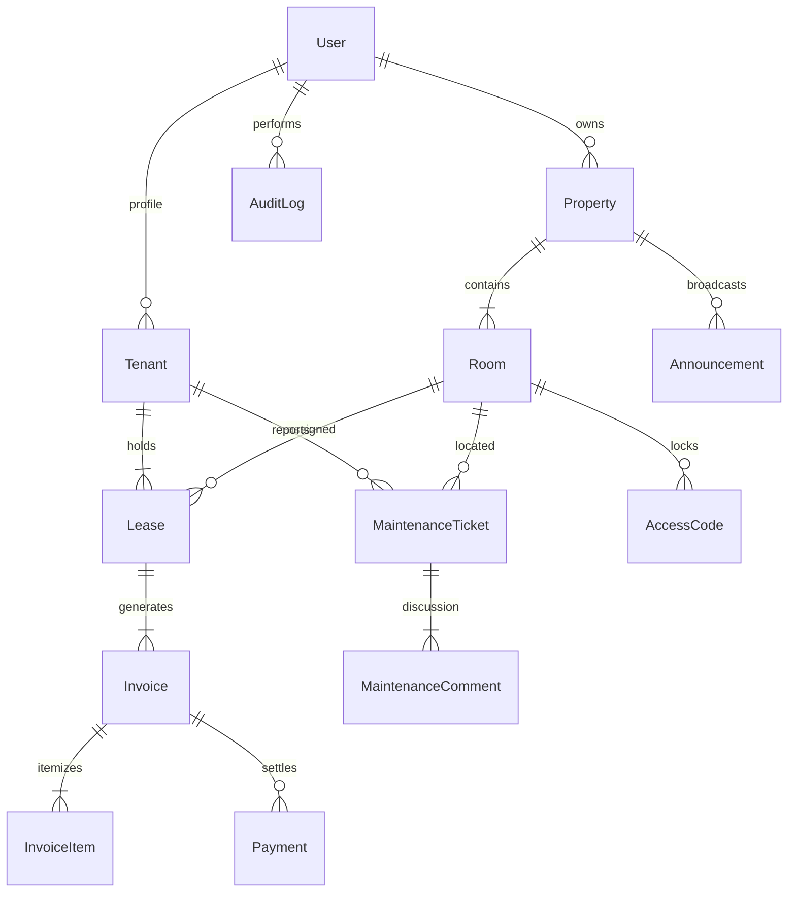

<div align="center">

# 🏠 Homia OS — Smart Property & Boarding House Management Platform

**Platform SaaS Manajemen Properti, Kos-kosan & Apartemen Modern Berbasis Cloud**

[](https://nextjs.org/)
[](https://www.typescriptlang.org/)
[](https://tailwindcss.com/)
[](https://nestjs.com/)
[](https://www.prisma.io/)
[](https://www.postgresql.org/)
[](https://turbo.build/)
[](LICENSE)

*Dibangun dengan standar arsitektur Enterprise Full-Stack: Next.js 15 App Router, NestJS, PostgreSQL, Prisma ORM, Redis BullMQ, dan Tailwind CSS (shadcn/ui).*

[Demo Live](#-link-demo--deployment) • [Fitur Utama](#-fitur-utama) • [Arsitektur Sistem](#-arsitektur-sistem) • [Panduan Instalasi](#-panduan-instalasi--menjalankan-lokal) • [Struktur Proyek](#-struktur-direktori-monorepo) • [Akun Demo](#-akun-demo-default)

---

</div>

## 📖 Tentang Homia OS

**Homia OS** adalah platform *SaaS (Software-as-a-Service)* komprehensif yang dirancang khusus untuk memecahkan kompleksitas operasional pemilik kos, pengelola apartemen, dan manajer properti di Indonesia dan Asia Tenggara. 

Bukan sekadar aplikasi CRUD sederhana, Homia OS menerapkan sistem otomasi penagihan bulanan yang *idempotent*, buku besar pembayaran *immutable* (tidak dapat dimanipulasi), *SLA-driven maintenance Kanban*, integrasi pengingat tagihan WhatsApp otomatis, hingga simulasi akses pintu *IoT Smart Lock*.

Platform ini mengadopsi konsep **Dual-Portal**:
1. **🏢 Property Manager Dashboard** (Web Desktop): Pusat komando pemilik & staf untuk mengontrol seluruh unit, keuangan, kontrak, dan operasional.
2. **📱 Tenant Mobile Portal** (Mobile-First): Portal ramah ponsel bagi penyewa untuk memantau sewa, tagihan rincian, unggah bukti bayar, mengajukan tiket komplain perbaikan, dan melihat pengumuman.

---

## ✨ Fitur Utama

### 🏢 1. Property Manager Dashboard (Pengelola & Owner)

- **Multi-Property Management**: Kelola banyak gedung properti sekaligus (contoh: *Homia Stay Menteng* & *Homia Stay Kemang*).
- **Interactive Visual Room Grid**:
  - Tampilan grid visual kartu kamar yang intuitif dengan indikator status warna: `AVAILABLE` (Hijau), `OCCUPIED` (Biru), `RESERVED` (Ungu), `MAINTENANCE` (Kuning), `OVERDUE` (Merah).
  - Filter cepat berdasarkan lantai, ketersediaan status, dan pencarian kamar.
  - *Slide-in Drawer*: Klik kamar untuk membuka detail penyewa, kontrak sewa aktif, tagihan berjalan, dan riwayat perbaikan tanpa berpindah halaman.
- **Tenant Management (KYC & Dokumen)**:
  - Pencatatan identitas lengkap penyewa: Nama, Email, Nomor WhatsApp, Tanggal Lahir, Jenis & Nomor KTP/Paspor, Foto Profil, serta Kontak Darurat keluarga.
- **Lease Pipeline & Expiry Alerts**:
  - Pelacakan masa aktif kontrak sewa dan uang jaminan (*security deposit*).
  - Peringatan otomatis menjelang masa sewa habis (**H-30**, **H-14**, **H-7**) untuk mempermudah perpanjangan (*renewal*) atau persiapan *check-out*.
- **Smart Automated Billing Engine**:
  - Pembuatan invoice sewa bulanan otomatis terintegrasi rincian: Sewa Pokok, Listrik, Air, Internet, Parkir, Denda Keterlambatan, dan Diskon.
  - **Idempotency Guarantee**: Dijamin tidak akan membuat tagihan ganda pada bulan yang sama berkat *execution lock* entitas `BillingJob`.
- **Immutable Payment Ledger**:
  - Antrean verifikasi bukti transfer pembayaran penyewa.
  - Sistem pencatatan keuangan *immutable* (tidak menghapus/mengubah transaksi lama demi audit finansial yang akuntabel).
- **Maintenance Kanban Board dengan SLA Timer**:
  - Papan kanban 5 kolom: `OPEN` ➔ `IN_PROGRESS` ➔ `WAITING` ➔ `RESOLVED` ➔ `CLOSED`.
  - **Live SLA Countdown**: Menghitung mundur batas waktu penyelesaian perbaikan kamar dan memberikan peringatan visual jika mendekati atau melanggar SLA.
- **Targeted Announcement Engine**:
  - Publikasi pengumuman digital dengan segmentasi target spesifik: Semua Penghuni (*All*), Per Gedung (*Property*), Per Lantai (*Floor*), atau Kamar Tertentu (*Room*).
- **Simulasi IoT Smart Lock**:
  - Pembuatan kode PIN akses sementara (6 digit) dengan batas waktu kadaluarsa (*TTL*) dan kuota pemakaian untuk teknisi AC, petugas kebersihan, atau calon penyewa baru.
- **Audit Logs & Security Trail**:
  - Log audit kriptografis mencatat setiap aksi administratif (aktor, entitas, timestamp, IP address) lengkap dengan tombol **Export CSV**.
- **Financial & Occupancy Analytics**:
  - Visualisasi grafik interaktif menggunakan **Recharts**: Tren Pendapatan Bulanan (AreaChart), Rasio Okupansi Kamar (DonutChart), Status Pembayaran (PieChart), dan Kategori Komplain Kerusakan (BarChart).

---

### 📱 2. Tenant Mobile Portal (Penyewa / Penghuni)

- **Mobile-First Responsive Layout**: Tampilan antarmuka yang dioptimalkan untuk layar ponsel dengan *Fixed Bottom Navigation Bar*.
- **Dashboard Ringkasan Kamar**: Menampilkan informasi kamar yang ditempati, fasilitas kamar, dan status kontrak aktif.
- **Itemized Billing & Upload Bukti Bayar**:
  - Rincian transparan tagihan sewa bulanan dan utilitas.
  - Modal unggah struk transfer ATM / screenshot m-banking dengan verifikasi status langsung (*Pending Review*, *Verified*, *Rejected*).
- **Ticketing Komplain Fasilitas (Maintenance)**:
  - Form pelaporan kerusakan fasilitas (AC, kran bocor, listrik, Wi-Fi) lengkap dengan pilihan prioritas (*Urgent*, *High*, *Medium*, *Low*).
  - Pelacakan status pengerjaan oleh teknisi secara *real-time*.
- **Digital Lease & Tata Tertib Kos**:
  - Akses detail kontrak sewa, data inventaris kamar, dan tata tertib hunian.
- **Notification Center**:
  - Pusat pemberitahuan resmi untuk invoice baru, pengingat jatuh tempo, konfirmasi pembayaran, tiket selesai, dan info pemadaman air/listrik.

---

### ⚡ 3. Portfolio & UX Differentiators

- **⌨️ Global Command Palette (`Ctrl + K` / `Cmd + K`)**: Cari kamar, penyewa, atau navigasi ke menu mana saja secara instan via keyboard shortcut.
- **💬 Generator Pengingat Tagihan WhatsApp**: Menghasilkan pesan pengingat tagihan berbahasa Indonesia yang rapi secara otomatis dan menyediakan tautan langsung *deep-link* ke `wa.me`.
- **🌓 Mode Gelap & Terang (Dark / Light Theme)**: Adaptasi tema otomatis dengan kontras tinggi yang nyaman di mata.
- **📊 Ekspor Data ke CSV**: Unduh data log audit, penyewa, dan transaksi keuangan ke dalam format file spreadsheet (.csv).

---

## 🛠️ Tech Stack & Arsitektur

Platform ini dibangun menggunakan arsitektur **Turborepo Monorepo**:

```text
homia-os/
├── apps/
│   ├── web/               # Frontend: Next.js 15 (App Router), Tailwind CSS, shadcn/ui, Recharts
│   └── api/               # Backend: NestJS, REST API, Passport JWT, BullMQ, Swagger Docs
├── packages/
│   ├── database/          # Database: Prisma ORM, Schema, Migrasi SQL, & Seed Data
│   ├── types/             # Shared Types: TypeScript Interfaces & Enums bersama
│   └── validation/        # Shared Validation: Skema validasi Zod
├── docker-compose.yml     # Multi-container orchestration (PostgreSQL 16, Redis 7, API, Web)
├── render.yaml            # Infrastructure-as-Code Blueprint untuk 1-Click deploy Render
├── turbo.json             # Pipeline orchestration Turborepo
└── package.json           # Root workspace configuration (npm workspaces)
```

| Lapisan | Teknologi | Penjelasan |
|---|---|---|
| **Frontend Web** | Next.js 15.5+ (App Router) | Server Components, Client Hydration, Layout Groups `(manager)` & `(tenant)` |
| **Styling & UI** | Tailwind CSS & shadcn/ui | Radix UI primitives, Lucide Icons, CSS Variables Theming |
| **State & Query** | TanStack React Query v5 | Server state caching, asynchronous mutations, optimisic UI |
| **Data Visualization** | Recharts v2 | Responsive SVG AreaChart, BarChart, PieChart |
| **Backend Framework**| NestJS v10 (Node.js) | Arsitektur modular (Controllers, Services, Modules, DTOs) |
| **Autentikasi** | Passport JWT & bcrypt | Access Token (15m), Refresh Token Rotation (7d), RBAC Guards |
| **Database & ORM** | PostgreSQL 16 & Prisma ORM | 16 Models, 18 Enums, Foreign Keys, Indexes, Soft Deletions |
| **Job Queue & Cache**| Redis 7 & BullMQ | Antrean latar belakang pemrosesan tagihan & pengingat berkala |
| **Validasi Data** | Zod & class-validator | Validasi masukan runtime pada sisi klien dan server |
| **Dokumentasi API** | Swagger / OpenAPI | Dokumentasi interaktif REST API di endpoint `/api/docs` |

---

## 🗄️ Desain Basis Data (Prisma Schema)

Skema database terdiri dari **16 Model relasional** yang dirancang sesuai kaidah normalisasi database:



### Entitas Utama:
- **`User`**: Akun pengguna dengan peran RBAC (`SUPER_ADMIN`, `PROPERTY_OWNER`, `STAFF`, `TENANT`).
- **`Property`**: Data gedung kos/apartemen, alamat, total lantai, dan fasilitas bersama.
- **`Room`**: Unit kamar, nomor, lantai, tipe, harga bulanan, dan status operasional.
- **`Tenant`**: Profil identitas penyewa, KTP, kontak darurat, dan data verifikasi KYC.
- **`Lease`**: Kontrak sewa kamar, tanggal mulai & selesai, deposit, dan tanggal jatuh tempo.
- **`Invoice`**: Tagihan bulanan unik per periode `[tenantId, leaseId, periodMonth, periodYear]`.
- **`InvoiceItem`**: Rincian tagihan (Sewa, Listrik, Air, Internet, Parkir, Denda).
- **`Payment`**: Buku besar pembayaran (*immutable ledger*), status verifikasi, dan URL bukti bayar.
- **`MaintenanceTicket`**: Tiket pelaporan perbaikan fasilitas, kategori, prioritas, SLA, dan status.
- **`AccessCode`**: Kode PIN cerdas sementara untuk pintu kamar dengan masa aktif waktu (*TTL*).
- **`AuditLog`**: Rekam jejak audit keamanan setiap manipulasi data dalam sistem.
- **`BillingJob`**: Pelacakan proses otomasi pembuatan invoice bulanan anti-duplikasi.

---

## 🚀 Panduan Instalasi & Menjalankan Lokal

Pastikan komputer Anda sudah terpasang:
- **Node.js** (versi 18 ke atas) & **npm**
- **Git**
- *(Opsional)* **Docker & Docker Desktop**

### Langkah 1: Clone Repository
```bash
git clone https://github.com/v0rade/Homia_App_2.git
cd Homia_App_2
```

### Langkah 2: Konfigurasi Environment Variable (.env)
Salin berkas template environment:
```bash
cp .env.example .env
```
Sesuaikan parameter database dan port sesuai kebutuhan (default sudah siap untuk pengembangan lokal).

---

### Cara A: Menjalankan Menggunakan Docker (Rekomendasi Paling Praktis)

Jika Anda memiliki Docker Desktop:
```bash
# 1. Jalankan container PostgreSQL & Redis
docker-compose up -d postgres redis

# 2. Jalankan migrasi dan isi data awal (seed)
npm run db:migrate
npm run db:seed

# 3. Jalankan aplikasi frontend dan backend
npm run dev
```

---

### Cara B: Menjalankan Frontend Web Secara Mandiri

Jika Anda ingin langsung menjelajahi antarmuka frontend (Next.js 15):
```bash
cd apps/web
npm install --legacy-peer-deps
npm run dev
```
Buka browser Anda di: 👉 **[http://localhost:3000](http://localhost:3000)**

---

## 🔑 Akun Demo Default

Basis data seed telah dilengkapi dengan akun siap pakai untuk berbagai skenario peran:

| Peran (Role) | Email | Password | Akses Portal |
|---|---|---|---|
| **Super Admin** | `admin@homia-os.com` | `Admin123!` | Akses Penuh Seluruh Sistem & Audit Logs |
| **Property Owner** | `owner1@homia-os.com` | `Admin123!` | Manajemen Properti, Keuangan & Kamar |
| **Staff Operasional** | `staff1@homia-os.com` | `Admin123!` | Kelola Tiket Maintenance & Verifikasi Bayar |
| **Penyewa (Tenant)** | `tenant1@homia-os.com` | `Admin123!` | Tenant Portal (Kamar A-203, Tagihan & Tiket) |

---

## 🌐 Rute Halaman Aplikasi

### 🏢 Manager Portal (`/`)
- `/dashboard` — Ringkasan performa bisnis, KPI kartu metrik, tren pendapatan & okupansi.
- `/rooms` — Grid visual kamar interaktif, filter lantai, filter status, drawer detail unit.
- `/properties` — Daftar dan pengelolaan properti (Gedung Menteng & Kemang).
- `/tenants` — Manajemen data penyewa dan verifikasi berkas KTP.
- `/leases` — Pipeline masa kontrak sewa dan notifikasi perpanjangan otomatis.
- `/invoices` — Daftar invoice tagihan sewa bulanan dan modal *generate billing*.
- `/payments` — Antrean verifikasi bukti transfer dan buku besar pembayaran.
- `/maintenance` — Kanban board 5 kolom tiket komplain dengan timer SLA.
- `/announcements` — Penyiaran pengumuman bersegmen target (Semua/Gedung/Lantai/Kamar).
- `/analytics` — Analitik multi-tab (Pendapatan MRR, Okupansi, Status Pembayaran, Kategori Komplain).
- `/audit-logs` — Jejak rekam audit aktivitas sistem & tombol unduh CSV.
- `/settings` — Generator PIN Smart Lock IoT dan konfigurasi gateway pembayaran.

### 📱 Tenant Portal (`/tenant`)
- `/tenant/dashboard` — Beranda mobile penyewa dengan informasi kamar & tagihan jatuh tempo.
- `/tenant/billing` — Rincian tagihan sewa, komponen utilitas, dan riwayat pembayaran.
- `/tenant/payments` — Form unggah bukti transfer m-banking / ATM.
- `/tenant/maintenance` — Pelaporan keluhan fasilitas kamar dan pemantauan perbaikan.
- `/tenant/lease` — Rincian masa sewa kamar, deposit jaminan, inventaris, dan tata tertib.
- `/tenant/profile` — Profil identitas diri, dokumen KTP, dan nomor kontak darurat keluarga.
- `/tenant/notifications` — Notifikasi resmi masuk (Invoice, Pembayaran, Tiket, Pengumuman).

---

## ☁️ Panduan Deployment ke Cloud

### 1. Deploy Frontend ke Vercel (Gratis & Rekomendasi Utama)
1. Buka [Vercel Dashboard](https://vercel.com/) dan masuk menggunakan akun GitHub.
2. Klik **"Add New..."** ➔ **"Project"** ➔ Import repository GitHub Anda.
3. Pada bagian **Root Directory**, pilih folder: `apps/web`.
4. Klik **"Deploy"**. Vercel akan otomatis membangun Next.js dan menghasilkan link publik HTTPS (contoh: `https://homia-os.vercel.app`).

### 2. Deploy Full-Stack ke Render (Menggunakan `render.yaml`)
1. Buka [Render Blueprints](https://dashboard.render.com/blueprints).
2. Hubungkan repository GitHub Anda.
3. Render akan membaca berkas `render.yaml` di root proyek dan otomatis menyiapkan:
   - Database PostgreSQL (`homia-postgres`)
   - Backend API NestJS (`homia-api`)
   - Frontend Web Next.js (`homia-web`)
4. Klik **"Apply"** untuk meluncurkan seluruh layanan.

---

## 💡 Konsep Rekayasa Perangkat Lunak Penting

### 1. Idempotent Billing Engine
Sistem penagihan bulanan mengeksekusi pemeriksaan status pada model `BillingJob` dan memberlakukan batasan komposit unik pada database:
`@@unique([tenantId, leaseId, periodMonth, periodYear])`
Hal ini menjamin bahwa meskipun cron job penagihan dijalankan berulang kali atau mengalami kegagalan koneksi di tengah proses, penyewa **tidak akan pernah ditagih dua kali** pada bulan yang sama.

### 2. Immutable Payment Ledger
Di industri pengelolaan properti, manipulasi catatan pembayaran lama adalah celah manipulasi pembukuan. Pada Homia OS, pembayaran yang sudah diverifikasi tidak dapat di-*edit* atau diubah nominalnya. Segala bentuk penolakan atau perubahan akan membuat entitas peristiwa baru demi menjamin integritas pembukuan finansial.

### 3. Dynamic SLA Calculation
Setiap tiket perbaikan memiliki atribut `slaHours` berdasarkan kategori dan prioritas (contoh: Darurat/Urgent = 4 jam). Mesin penghitung SLA di backend menghitung selisih waktu pembuatan tiket dengan waktu saat ini, lalu secara otomatis menandai tiket dengan status *Approaching SLA* atau *Breached SLA*.

---

## 🤝 Kontribusi

Kontribusi kode selalu disambut dengan baik! Jika Anda menemukan bug atau memiliki usulan fitur baru:
1. *Fork* repository ini.
2. Buat branch fitur baru (`git checkout -b feature/FiturKeren`).
3. Lakukan commit perubahan Anda (`git commit -m 'feat: tambah fitur keren'`).
4. *Push* ke branch Anda (`git push origin feature/FiturKeren`).
5. Buka sebuah *Pull Request*.

---

## 📄 Lisensi

Proyek ini didistribusikan di bawah lisensi **MIT License**. Lihat berkas `LICENSE` untuk informasi selengkapnya.

<div align="center">

Dibuat dengan ❤️ untuk merevolusi manajemen hunian kos & properti di Indonesia.

</div>
